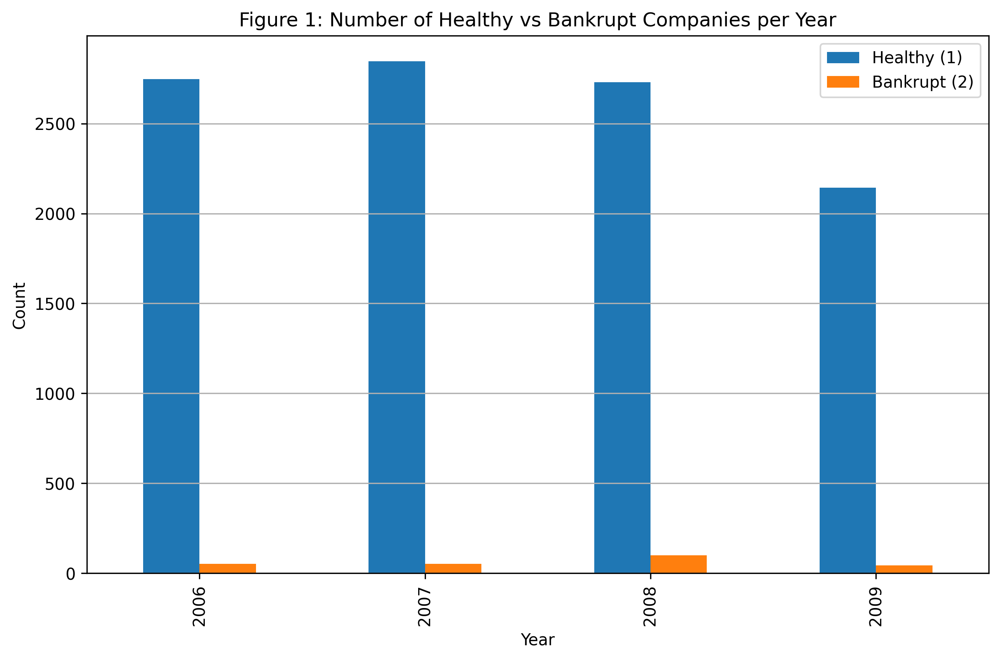

# Bankruptcy Prediction with Classification Models

Machine Learning course project, Department of Applied Informatics, University of Macedonia (January 2026).

The goal is to predict whether a company will go bankrupt the following year, using its financial ratios and activity indicators. Eight classifiers are trained and compared on a highly imbalanced dataset (about 42 healthy companies for every bankrupt one).

## Dataset

- **Size:** about 10,700 company-year records, no missing values
- **Features (11):** 8 financial performance ratios and 3 binary activity indicators
- **Target:** company status the following year (healthy or bankrupt)
- **Challenge:** strong class imbalance, with bankrupt companies making up only about 2% of the data

## Approach

1. **Exploratory analysis:** missing-value report, healthy vs bankrupt companies per year, and distributions of the financial ratios by class
2. **Preprocessing:** Min-Max scaling of the financial ratios to the [0, 1] range
3. **Validation:** Stratified 4-fold cross-validation, so every fold keeps the same class ratio
4. **Class balancing:** random undersampling of healthy companies in the training set down to a 3:1 ratio (558 healthy vs 186 bankrupt per fold), with fixed seeds for reproducible results. The test set is left untouched, so it reflects the real class ratio.
5. **Models:** Linear Discriminant Analysis, Logistic Regression, Decision Tree, Random Forest, k-Nearest Neighbours, Naive Bayes, Support Vector Machine and Gradient Boosting
6. **Evaluation:** confusion matrices (TP, TN, FP, FN) and ROC-AUC for every model and fold, exported to CSV. Accuracy, precision, recall, specificity, F1 and balanced accuracy were then calculated and compared in Excel with pivot tables and charts.

## Results

Mean test-set scores across the 4 folds:

| Model | F1 | Recall | Specificity | ROC-AUC |
|---|---|---|---|---|
| **Random Forest** | **0.197** | 0.452 | 0.925 | **0.852** |
| SVM | 0.197 | 0.371 | 0.942 | 0.835 |
| LDA | 0.191 | 0.415 | 0.929 | 0.832 |
| Logistic Regression | 0.186 | 0.351 | 0.942 | 0.830 |
| Gradient Boosting | 0.185 | 0.484 | 0.912 | 0.840 |
| KNN | 0.166 | 0.504 | 0.892 | 0.810 |
| Naive Bayes | 0.155 | 0.524 | 0.876 | 0.822 |
| Decision Tree | 0.100 | 0.476 | 0.810 | 0.643 |

**Key findings**
- **Random Forest** performed best, with the highest F1 score and ROC-AUC, followed closely by SVM.
- All models correctly identified more than 80% of the healthy companies (specificity), but none caught 60% or more of the bankrupt ones (recall), so none met both targets set in the assignment.
- F1 scores stayed low for every model. Predicting bankruptcy is hard when bankrupt companies are this rare, and undersampling also reduces the amount of training data.

The full report (in Greek) with charts and discussion: [bankruptcy_classification_report (1).pdf](bankruptcy_classification_report%20(1).pdf)

## Repository contents

| File | Description |
|---|---|
| [ML_Assignment1_Classification.ipynb](ML_Assignment1_Classification.ipynb) | Full code as a Google Colab notebook |
| [Dataset2Use_Assignment1 (1).xlsx](Dataset2Use_Assignment1%20(1).xlsx) | Dataset |
| [balancedDataOutcomes (1).csv](balancedDataOutcomes%20(1).csv) | Confusion matrix values and ROC-AUC for every model, fold and set |
| [balancedDataOutcomes (1).xlsx](balancedDataOutcomes%20(1).xlsx) | Results with calculated metrics, pivot tables and charts |
| [bankruptcy_classification_report (1).pdf](bankruptcy_classification_report%20(1).pdf) | Final report |
| [1η_εργασία_Classification.pdf](1%CE%B7_%CE%B5%CF%81%CE%B3%CE%B1%CF%83%CE%AF%CE%B1_Classification.pdf) | Assignment description |

## How to run

1. Open [Google Colab](https://colab.research.google.com/)
2. **File → Upload notebook** and select `ML_Assignment1_Classification.ipynb`
3. In Google Drive, create a folder named `Datasets` and upload the dataset there as `Dataset2Use_Assignment1.xlsx`
4. **Runtime → Run all** and allow access to Google Drive when asked

## Tools

Python · pandas · NumPy · scikit-learn · matplotlib · seaborn · Excel · Google Colab

## Skills gained

- **Exploratory data analysis:** checking data quality and visualising class distributions over time
- **Preprocessing:** scaling financial features with Min-Max normalisation
- **Imbalanced data:** handling a 42:1 class ratio with stratified splits and random undersampling, applied to the training set only to avoid data leakage
- **Classification modelling:** training and comparing eight classifiers (linear, tree-based, ensemble, distance-based, probabilistic and SVM) with scikit-learn
- **Model evaluation:** confusion matrices, ROC-AUC and choosing the right metrics (F1, recall, specificity, balanced accuracy) when classes are imbalanced
- **Reproducible experiments:** fixed random seeds and an automated loop that logs 64 results to CSV
- **Results analysis in Excel:** calculated metrics, pivot tables and charts
- **Reporting & teamwork:** writing a technical report as part of a team of four

